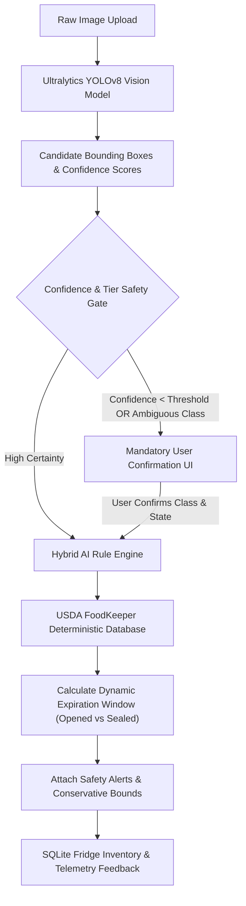

# AI Ethics & Bias Audit: Automated Fridge Inventory & Food Safety Systems

**Course / Project:** CSCI 270 - Project 2: Fridge Tracker AI  
**Focus Area:** Computer Vision Fairness, Dataset Representation Bias, and Public Health Reliability for Vulnerable Populations  
**Status:** Completed Audit & Architectural Safeguard Specification  

---

## Executive Summary

The deployment of computer vision models in domestic food management systems creates an intersection between algorithmic perception and acute public health risk. Unlike general consumer image classification tasks where a misclassification results in minor user inconvenience, food safety applications carry asymmetric risks: misclassifying a high-pathogen perishable can lead to severe foodborne illness or death.

This audit provides a comprehensive ethical and demographic analysis of the machine learning pipeline powering the **Fridge Tracker** application. It examines:
1. **Dataset Provenance & Cultural Monoculture:** The severe Western-dietary skew present in public Roboflow and computer vision datasets.
2. **Packaging & Socioeconomic Inequities:** The systemic bias toward pristine, commercially branded supermarket products at the expense of repackaged, bulk, or food-pantry goods.
3. **Disproportionate Harm to Vulnerable Populations:** The heightened physiological vulnerability of immunocompromised individuals, pregnant women, the elderly, and infants to microbial pathogens (*Listeria monocytogenes*, *Salmonella*, Shiga toxin-producing *E. coli*).
4. **Hardware & Environmental Disparities:** Performance degradation under non-ideal hardware, low-light kitchen environments, and sensor noise.
5. **Architectural Safeguards & Hybrid Mitigation:** The necessity of replacing purely probabilistic neural inference with a deterministic, rule-gated hybrid architecture paired with mandatory human-in-the-loop verification.

---

## 1. Dataset Provenance and Cultural Bias Analysis

### 1.1 Source Datasets and Western Dietary Centricity
The vision model was trained on aggregated public datasets (`Fridge objects.v2i.yolov8`, `Hien_Fridge.v12i.yolov8`, and `aicook.v1i.yolov8`) totaling 2,423 cleaned images across 38 food classes. An audit of class distribution reveals a profound dietary monoculture centered around Western European and North American grocery consumption:

| Broad Category | Representation in Training Split | Example Classes | Omitted Global Staples |
|---|---|---|---|
| **Dairy & Bovine Products** | **Extremely Overrepresented** (3,800+ instances) | `milk` (1,261), `egg` (1,245), `cheese` (532), `butter` (395), `cream` (183), `yogurt` (532) | Soy milk, oat milk, kefir, paneer, labneh, yak butter, halloumi |
| **Western Meats** | **Moderately Represented** (970+ instances) | `beef` (258), `chicken` (337), `bacon` (218), `ham` (77) | Halal/Kosher butchered cuts, mutton, goat, organ meats, tripe, duck, dried salted fish |
| **Global & Non-Western Produce** | **Severely Underrepresented or Absent** (< 2% total) | `persimmon` (154), `mango` (53), `pomegranate` (74) | Plantains, cassava/yuca, bitter melon, bok choy, daikon, lotus root, okra, chayote |
| **Legumes & Fermented Staples** | **Completely Absent (0 instances)** | None | Tofu, tempeh, natto, kimchi, lentils, chickpeas, black beans, edamame, miso |

### 1.2 Quantitative Class Imbalance and Long-Tail Erasure
The dataset exhibits acute Pareto distribution imbalance:
- The top two classes (`milk` with 1,261 boxes and `egg` with 1,245 boxes) comprise **27.8% of all labeled instances**.
- In contrast, critical foods such as `mango` (53 boxes), `ham` (77 boxes), and `chocolate` (86 boxes) represent the fragile long-tail.
- **The "Others" Dilemma:** In raw datasets like `Hien_Fridge`, 2,408 boxes were initially labeled as `others`—a catch-all dumping ground for non-Western or unidentifiable items. While manual relabeling recovered items like `jar` (703), `mango` (277), and `orange` (557), hundreds of culturally diverse foods were permanently discarded because standard Western vision taxonomies had no vocabulary for them.

### 1.3 Linguistic and Regulatory Hegemony
The underlying shelf-life database relies on the **USDA FoodKeeper** export. While scientifically rigorous, FoodKeeper inherently reflects United States Department of Agriculture regulatory standards, terminology, and industrial food supply practices:
- Definitions presume continuous mechanical refrigeration at or below 40°F (4.4°C), which is not universal across all global regions or household electrical realities.
- Food categories use English-language commercial descriptors ("half-and-half", "bacon", "deli ham") that do not map to traditional, ethnic, or indigenous food preservation preparations (e.g., curing, drying, pickling in oil, fermenting).

---

## 2. Socioeconomic and Packaging Bias

### 2.1 The "Supermarket Aesthetic" Failure Mode
Public computer vision datasets exhibit an implicit class and wealth bias in their visual ontology:
- **Pristine Commercial Packaging:** Models are predominantly trained on clean, barcode-visible, factory-sealed plastic jugs, tetra paks, egg cartons, and Styrofoam-and-shrinkwrap meat trays.
- **Informal, Repackaged, and Bulk Storage:** Low-income families, community food pantry recipients, and zero-waste households frequently store food in non-commercial formats:
  - Food distributed in generic clear plastic bags without branding.
  - Reused glass pasta jars holding homemade stocks, grains, or bulk beans.
  - Foil-wrapped or butcher-paper-wrapped meats portioned from bulk purchasing.
  - Plastic food-storage containers (Tupperware, deli containers) with opaque or frosted lids.

When exposed to informal containers, the vision model experiences catastrophic confidence collapse or outputs spurious classifications (e.g., misclassifying a plastic container of homemade chicken stew as "butter" or "cheese").

### 2.2 Socioeconomic Inequity in False Predictions
The consequences of model errors fall unevenly across socioeconomic strata:
- **False Positives (Spurious Early Expiration):** If the system prematurely flags food as spoiled or sets unrealistically tight windows, higher-income households might discard the food with minor economic friction. For food-insecure households surviving on tight budgets or food assistance (SNAP/WIC), following erroneous discard recommendations leads to severe nutritional deprivation and financial waste.
- **False Negatives (Over-optimistic Shelf Life):** Low-income households reliant on second-chance groceries, damaged packaging, or pantry donations already near the end of their shelf life are at the highest risk if an algorithm falsely certifies that an item is safe for another week.

---

## 3. Model Reliability and Disproportionate Harm to Vulnerable Populations

### 3.1 Acute Microbial Risks & Asymmetric Error Cost
Foodborne illness is not distributed symmetrically. In algorithmic safety, **Type I errors (False Alarms)** and **Type II errors (Missed Hazards)** have radically divergent moral weights:

```
                        Model Predicts Safe / Long Window
                                     │
                    ┌────────────────┴────────────────┐
                    ▼                                 ▼
           Item is actually safe            Item is actually spoiled / raw
             [True Negative]                      [False Negative]
            Normal consumption.              ACUTE PUBLIC HEALTH HAZARD
                                            Severe microbial ingestion
                                            Hospitalization / Sepsis / Death
```

### 3.2 High-Risk Vulnerable Demographics
Four primary populations face life-threatening consequences from model misclassifications:

1. **Immunocompromised Individuals:** Chemotherapy patients, organ transplant recipients on immunosuppressive regimens, and persons with advanced HIV have minimal defenses against opportunistic intracellular pathogens like *Listeria monocytogenes*. While healthy adults may experience mild gastroenteritis, immunocompromised hosts face invasive listeriosis, bacteremia, and meningitis, with case-fatality rates exceeding 20-30%.
2. **Pregnant Women & Fetuses:** *Listeria* exhibits tropism for the placenta. An expectant mother may present with mild flu-like symptoms while the pathogen causes chorioamnionitis, spontaneous abortion, stillbirth, or neonatal meningitis. If a model misclassifies soft raw-milk cheese (`goat_cheese`) or opened sliced deli meat (`ham`) as low-risk produce, the maternal-fetal unit is placed in grave danger.
3. **The Elderly (Geriatric Population):** Immune senescence, diminished gastric acid secretion, and polypharmacy reduce mucosal barriers against *Salmonella enterica* and *Campylobacter jejuni*. Elderly patients rapidly succumb to hypovolemic shock, dehydration, and acute kidney injury following food poisoning.
4. **Infants and Young Children:** Developing immune systems and lower body weight render pediatric populations exceptionally susceptible to Shiga toxin-producing *Escherichia coli* (STEC, e.g., *E. coli* O157:H7) commonly harbored in improperly stored raw ground beef. STEC infection can trigger Hemolytic Uremic Syndrome (HUS), leading to irreversible renal failure.

### 3.3 The Specific Danger of the Ground Beef vs. Whole Beef Distinction
A concrete technical demonstration of this risk was uncovered in `ml/configs/cleaning_report.md` and `ml/runs/eval_baseline_v8n/safety_class_analysis.json`:
- In the raw datasets, `ground_beef` was merged into the generic class `beef`.
- Whole muscle beef (steaks and roasts) has bacteria primarily restricted to exterior surfaces, which are killed during surface searing. According to USDA FoodKeeper, steaks can be safely refrigerated for **3 to 5 days**.
- In ground beef, surface pathogens are blended throughout the interior matrix during grinding. USDA guidelines strictly mandate that raw ground beef must be cooked or frozen within **1 to 2 days**.
- If a computer vision model detects ground beef, labels it generically as `beef`, and assigns a 5-day shelf life, a consumer holding raw ground meat on day 4 faces an exponential surge in microbial colony-forming units (CFUs).

---

## 4. Hardware and Environmental Inequities

Visual inference does not operate in ideal laboratory conditions. Real-world refrigerators present significant optical challenges that disproportionately impact users with lower-end technology:

1. **Camera Sensor Disparities:** Users with older or budget smartphones encounter low dynamic range, intense chromatic noise in shadow areas, and poor auto-focus compared to flagship mobile devices.
2. **Refrigeration Lighting Conditions:** Domestic refrigerators often have single-point incandescent or low-CRI LED lighting located on the top shelf. Lower and crisper shelves exist in semi-darkness, creating severe backlighting and shadow occlusion.
3. **Condensation, Frost, and Reflection:** Moving cameras into cold refrigerator compartments frequently fogs optical lenses. Furthermore, plastic wrap and glass shelves generate specular glare that degrades convolutional feature extraction.
4. **Spatial Occlusion:** Crowded refrigerators feature heavily stacked and partially visible items. A model that only sees 15% of a chicken package may predict background or mistake it for a benign vegetable.

---

## 5. Algorithmic Accountability and Mitigation Architecture

To ethically address these failure modes, the Fridge Tracker system rejects pure end-to-end "black box" deep learning in favor of a **Deterministic Hybrid Architecture**:



### 5.1 Core Ethical Safeguards Implemented

1. **Deterministic Bounding (Separation of Perception and Policy):**  
   The neural network is strictly confined to perceptual candidate proposal. It is **never** permitted to generate or interpolate expiration timelines. Dynamic timelines are queried deterministically from the USDA FoodKeeper table based on verified state (opened vs. sealed, refrigerator vs. freezer).
2. **Fail-Safe Conservative Defaults:**  
   When the model encounters an unmapped food item or low-confidence detection, it defaults to a conservative perishable window (1–2 days) accompanied by an explicit warning prompt rather than an optimistic guess.
3. **Mandatory Human-in-the-Loop for Ambiguous & High-Consequence Classes:**  
   - Any detection of container classes (`jar`) is prohibited from receiving automated food guidance until the user explicitly specifies the contents.
   - Tier 1 meats (`beef`, `chicken`, `shrimp`, `ground_beef`) trigger interactive detail prompts (`"Is this raw or cooked?"`, `"Is this whole cut or ground meat?"`).
4. **Dynamic Expiration Adjustments upon Package Opening:**  
   The system provides a dedicated endpoint (`/api/inventory/{id}/duration`) that dynamically shrinks expiration windows immediately when a user toggles an item from `sealed` to `opened` (e.g., milk drops from 7 days to 5 days; bacon drops from 14 days to 7 days).
5. **Continuous Telemetry & Error Audit Logging:**  
   Every user correction or rejected false positive from the frontend is recorded in `model_feedback` with normalized bounding boxes and timestamps. This provides an immutable audit trail to identify demographic drift, systematically misidentified ethnic foods, and recurring false positives before retraining.

---

## 6. Recommendations for Future Iterations

1. **Culturally Inclusive Active Learning:** Actively source fridge imagery from international households, diaspora markets, and non-Western cuisines (Asian, Latin American, African, Middle Eastern) to expand beyond the current 38 Western-centric classes.
2. **Food Insecurity & Pantry Partnership:** Collaborate with community food banks to collect and label imagery of non-commercial packaging, portioned containers, and unbranded distribution goods.
3. **Multilingual and Accessible UI:** Translate FoodKeeper guidelines and warning prompts into Spanish, Mandarin, Vietnamese, Arabic, and Tagalog to ensure equitable access for non-native English speakers.
4. **Microbial Risk Disclaimers:** Incorporate explicit UI warnings targeted to vulnerable populations (e.g., `"Pregnant or immunocompromised individuals should follow the shortest recommended storage interval and avoid unpasteurized soft cheeses or undercooked deli meats."`).

